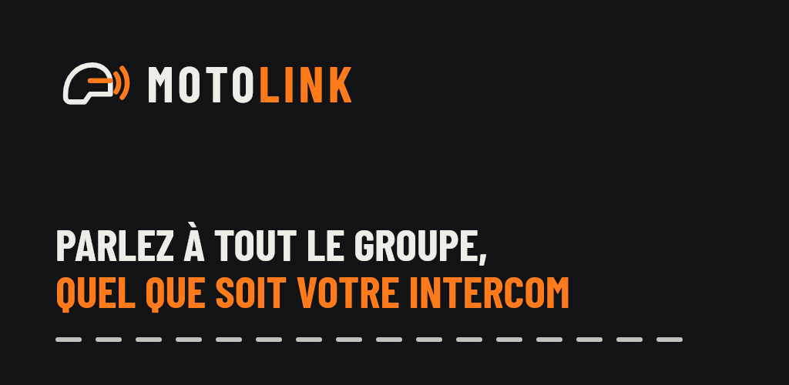
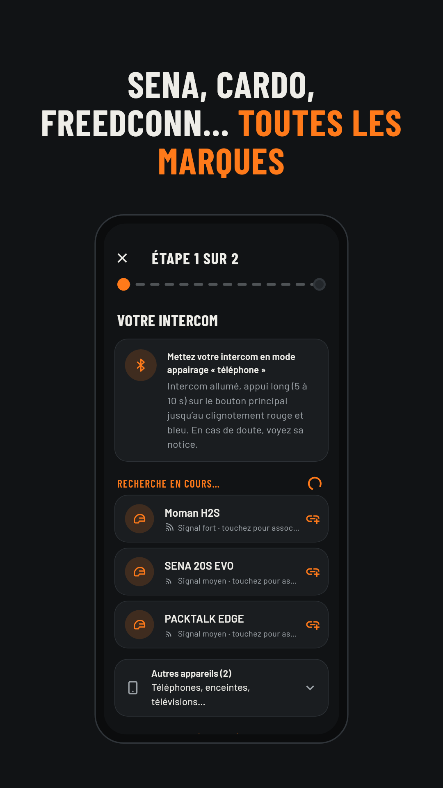
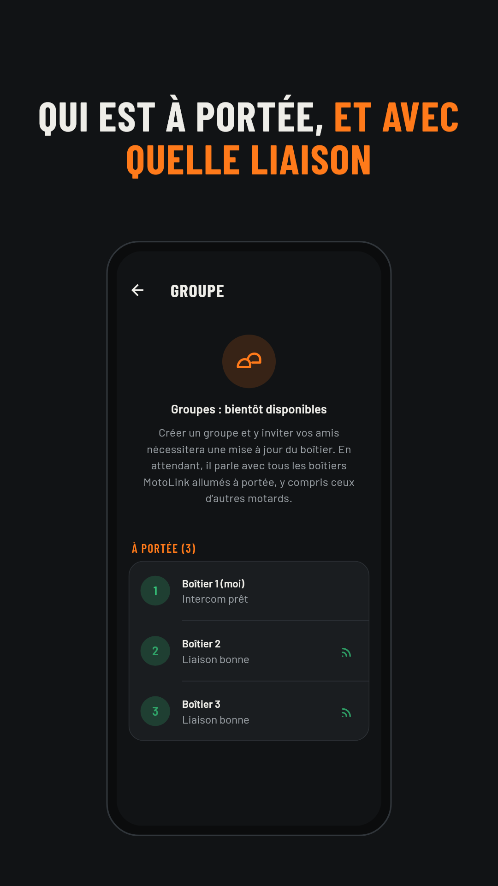
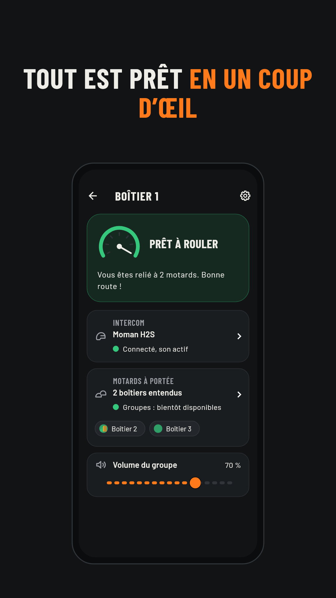

# MotoLink pour Android

Application de configuration du **boîtier intercom universel MotoLink** : associez l'intercom de votre casque, voyez les motards à portée, réglez le volume. Les groupes arriveront avec une mise à jour du boîtier.

Ce dépôt ne contient que les fichiers d'installation. Chaque version est publiée automatiquement dans les [**Releases**](../../releases).

<p>
  
  
  
</p>

## Installer

1. Sur votre téléphone Android, ouvrez la [dernière release](../../releases) et touchez **`MotoLink-X.Y.Z.apk`**.
2. Ouvrez le fichier téléchargé. Android demande d'autoriser l'installation depuis votre navigateur : acceptez, puis **Installer**.
3. Lancez MotoLink. Pas de boîtier sous la main ? Touchez « Essayer sans boîtier (démo) ».

Android 7.0 ou plus récent, Bluetooth basse consommation requis.

## Mises à jour

Rien à faire : MotoLink vérifie lui-même s'il existe une nouvelle version et vous la propose (menu ⋮ → *Rechercher une mise à jour* pour vérifier tout de suite). L'application télécharge le fichier, **vérifie son empreinte SHA-256**, puis Android vous demande de confirmer l'installation. Vos boîtiers mémorisés et vos réglages sont conservés.

## Vérifier un fichier

Chaque release contient `SHA256SUMS-android.txt`. Pour contrôler un APK téléchargé à la main :

```bash
sha256sum -c SHA256SUMS-android.txt --ignore-missing
```

## Confidentialité

L'application ne collecte aucune donnée et ne contacte qu'un seul serveur : l'API publique de GitHub, pour savoir si une nouvelle version existe.
